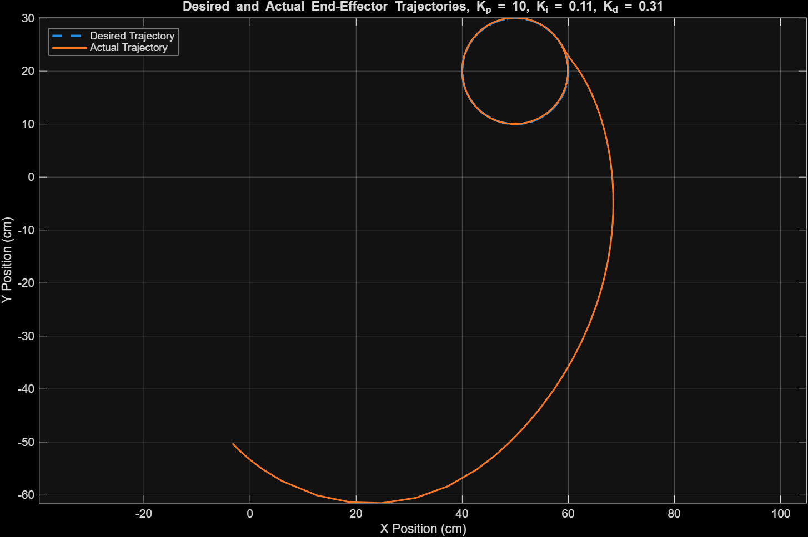
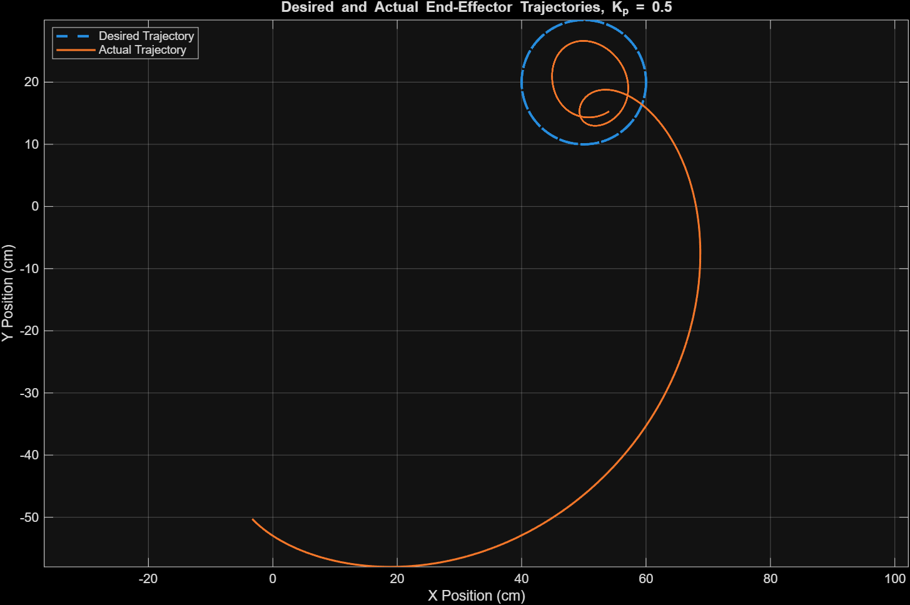
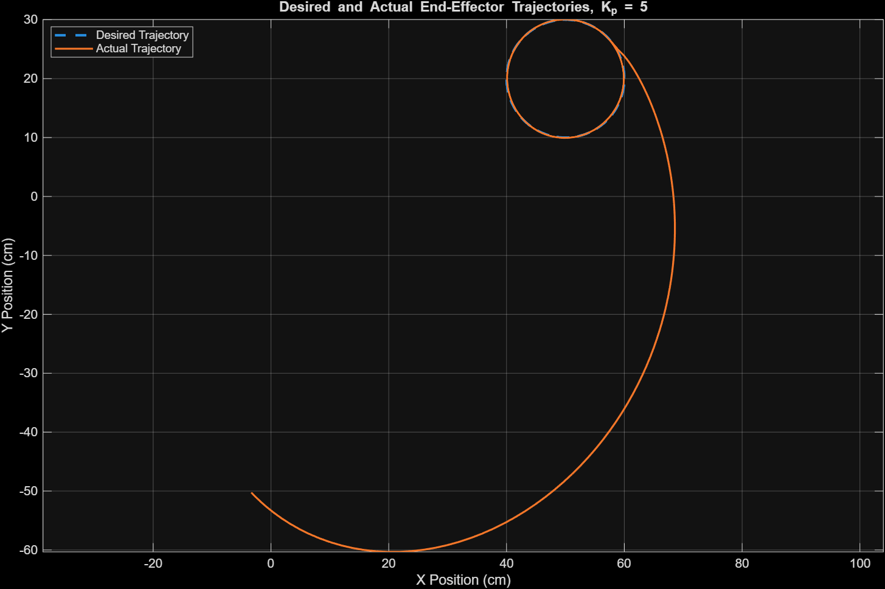

# Two-DOF Robotic Arm | Trajectory Tracking & PID Control

**Linear Control Systems Laboratory - Final Project (Part II)**

A MATLAB/Simulink and Simscape Multibody study of a **two-degree-of-freedom planar robotic arm**. The project generates a circular end-effector reference, implements forward and inverse kinematics, and evaluates joint-space P, PI, and PID control for trajectory tracking.

> **Scope:** This repository includes **only Part II (robotic arm)** of the course project. The DC motor identification/control work from Part I is intentionally excluded.

## Project at a glance

| Item | Description |
|---|---|
| Platform | MATLAB, Simulink, Simscape Multibody |
| Robot | Two-link, two-revolute-joint planar manipulator |
| Link lengths | L1 = 40 cm, L2 = 30 cm |
| Reference motion | 10-cm-radius circle centered at (50, 20) cm; period 5 s |
| Control study | Proportional (P), proportional-integral (PI), derivative term, and tuned PID |
| Final reported gains | **Kp = 10, Ki = 0.11, Kd = 0.31** for both joints |
| Reported mean position-tracking error | **1.2754 cm** over the simulation, including the initial transient |

## Reference trajectory

The desired Cartesian position is defined as

```text
xd(t) = 50 + 10*cos(2*pi*t/5)   [cm]
yd(t) = 20 + 10*sin(2*pi*t/5)   [cm]
```

Inverse kinematics maps `(xd, yd)` to desired joint angles; the measured joint angles are fed back to two joint controllers. Forward kinematics reconstructs the actual end-effector position for comparison with the reference trajectory.

## Results

### Tuned controller - final end-effector trajectory



**Final reported controller:** `Kp = 10`, `Ki = 0.11`, `Kd = 0.31`. The measured trajectory approaches the reference circle after the large start-up transient caused by the initial configuration. The **mean Cartesian position error reported in the submitted course report is 1.2754 cm**; this number includes the initial transient.

### Proportional gain comparison

| Lower gain, Kp = 0.5 | Higher gain, Kp = 5 |
|---|---|
|  |  |

The study also varies `Ki` and `Kd` and examines joint torque outputs. Additional images for **all seven tasks** are provided in [`results/figures`](results/figures), with selected robot animations in [`results/videos`](results/videos).

### Video demonstration

[Watch the final PID robot motion](results/videos/q7_final_pid.mp4) (MP4). Other examples compare P, PI, and derivative-gain settings.

## Repository structure

```text
models/
  Q1.slx                        Reference trajectory generation
  Q2.slx                        Forward and inverse kinematics
  Q3_Q4_Q5_Q6_Q7.slx            Closed-loop control and gain studies
  LCLProject.slx                Imported Simscape Multibody robot model
  LCLProject_DataFile.m         Mechanical parameters / model initialization
  *_Default_sldprt.STEP         3D geometries used by the model
cad/                            Original course-supplied CAD assembly and parts
results/figures/                All saved Part II simulation plots
results/videos/                 Selected simulations (5 videos)
report/Technical_Report_EN.pdf  Short English technical report
```

## How to run

**Requirements:** MATLAB with Simulink and Simscape Multibody. The original model was prepared in a MATLAB/Simulink environment compatible with the provided `*.slx` files; release compatibility should be checked locally.

1. Download/clone this repository, and open MATLAB in the repository root.
2. Add model paths to MATLAB and initialize the Simscape robot model:

   ```matlab
   addpath(genpath(fullfile(pwd, 'models')));
   cd('models');
   LCLProject_DataFile;
   ```
3. Open the relevant model: `Q1.slx` (reference), `Q2.slx` (kinematics), or `Q3_Q4_Q5_Q6_Q7.slx` (control experiments).
4. Run the simulation. In the combined model, set the P, I, and D gains to the case you wish to reproduce. The saved controller configuration may differ from the final settings reported above; set them explicitly before comparing results.
5. For the original imported mechanical model, open `LCLProject.slx`. The STEP files must remain on the MATLAB path / in the same model folder so that visual geometries can be loaded.

**Portability adjustment:** The absolute, computer-specific reference to `LCLProject_DataFile.m` in the imported model workspace was replaced with its **relative filename**. No control algorithm or simulation parameter was changed.

The models have **not been re-executed in this publication workflow**; the plots and measurements here come from the existing course-project results.

## Technical report

[Read the two-page English technical report](report/Technical_Report_EN.pdf) for methodology, gain comparisons, figures, quantitative tracking error, and conclusions.

## Notes and limitations

- This is a **simulation-based** project; no physical robotic-arm validation is claimed.
- The robot is nonlinear and mechanically coupled. A single fixed PID setting may not perform equally well on other trajectories, payloads, or initial configurations.
- Joint actuator saturation, measurement noise, and hardware uncertainties are not validated experimentally here.
- The base CAD/mechanical assets were supplied as part of the course materials; this repository documents their use for control simulation and does not claim original design authorship of those assets.
- Only five representative motion videos are included to keep the repository compact. The corresponding saved plots for the full reported study are included.

## References

- *Linear Control Systems Laboratory*, Final Project instructions, **Part II: Two-DOF Robotic Arm** (course handout).
- Simulink and Simscape Multibody software documentation (MathWorks).
